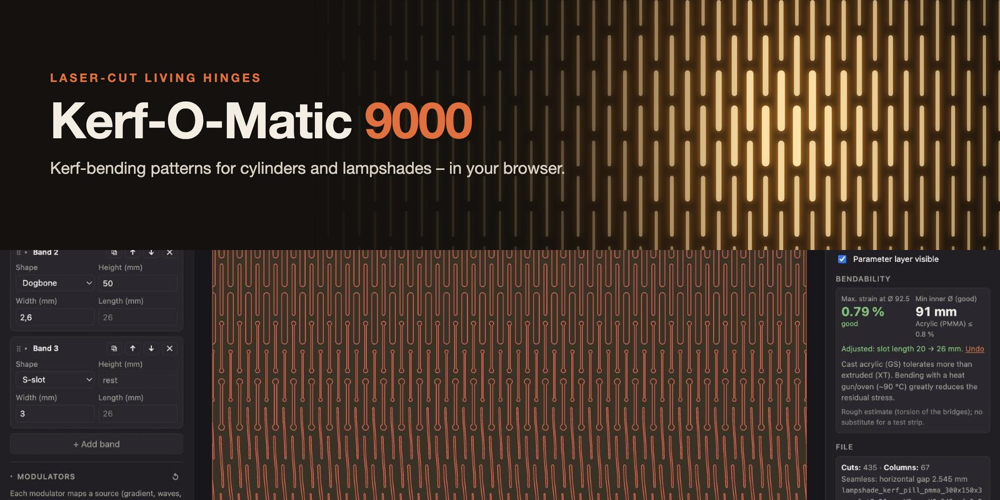
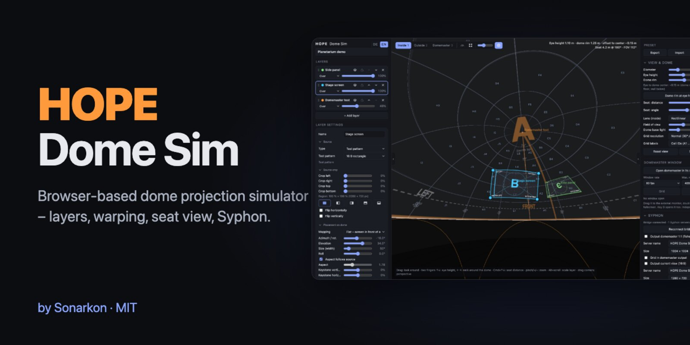
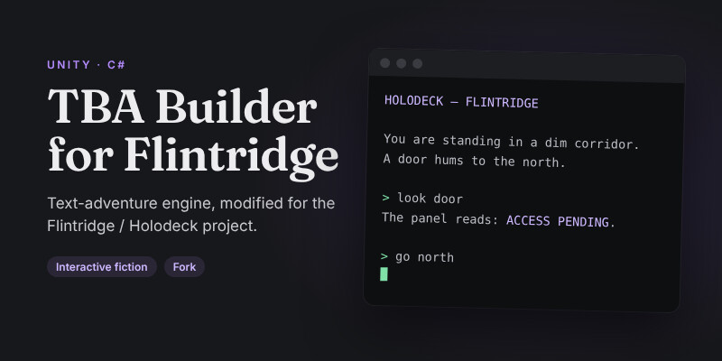
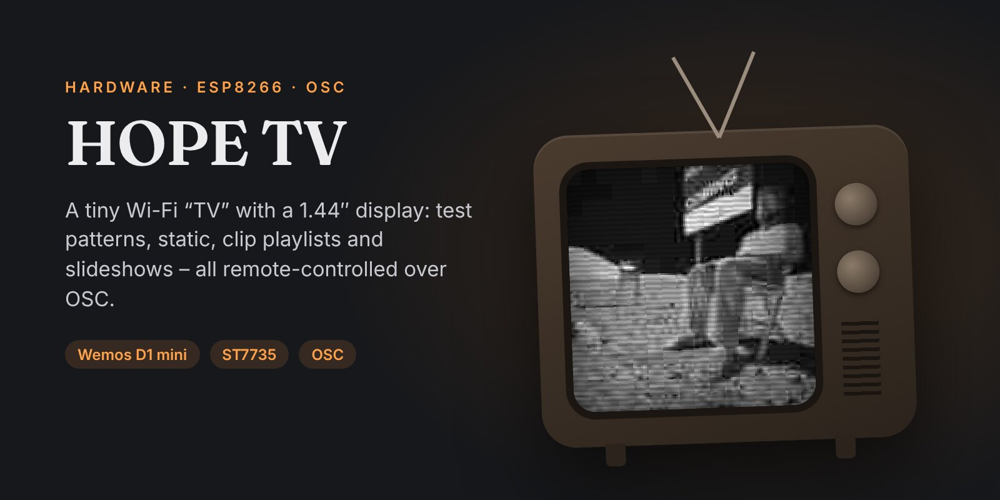
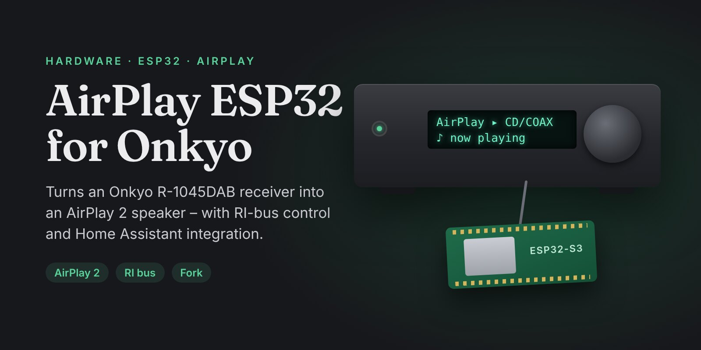
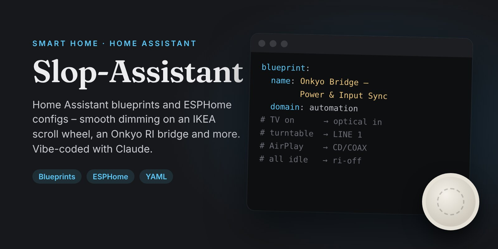

### Hi, I'm sonarkon 👋

I build small tools for stage and projection. I take apart electronics to make them do new things.

## 🛠 Software

<table>
<tr>
<td width="50%" valign="top">

VIDEO · DESKTOP APP
### [Common Shrew](https://github.com/sonarkon/Common-Shrew)
Shrinks videos to a target size, tuned to Vimeo's upload specs. It encodes H.265 in two passes, has size presets for other platforms, and offers drag & drop with a hover-scrub preview.

</td>
<td width="50%" valign="top">

FABRICATION · BROWSER
### [Kerf-O-Matic 9000](https://github.com/sonarkon/Kerf-O-Matic-9000)
Laser-cut living-hinge patterns for cylinders and pendant lampshades. It estimates how far each pattern will bend, previews it in 3D and exports SVG, STL and OBJ – all in a single HTML file.

▶ **[Open in browser](https://sonarkon.github.io/Kerf-O-Matic-9000/)**

</td>
</tr>
</table>

## 🎭 Stage & interactive

<table>
<tr>
<td width="50%" valign="top">

FULLDOME · BROWSER
### [HOPE Dome Sim](https://github.com/sonarkon/Dome-Sim)
Browser-based dome projection simulator with up to 8 layers, warping and blend modes. You can check the result from any seat and output a domemaster via Syphon or to a second screen.

▶ **[Try it online](https://sonarkon.github.io/Dome-Sim/)**

</td>
<td width="50%" valign="top">

INTERACTIVE · UNITY
### [TBA Builder for Flintridge](https://github.com/sonarkon/TBA-Builder-for-Flintridge)
Text-adventure builder for Unity, customised for Flintridge / Holodeck. This version adds a German language mode, extOSC control and other tweaks. Fork of [popcar2/Pops-TBA-Builder](https://github.com/popcar2/Pops-TBA-Builder).

</td>
</tr>
</table>

## 🔌 Hardware hacks

<table>
<tr>
<td width="50%" valign="top">

ESP8266 · OSC
### [HOPE TV](https://github.com/sonarkon/HOPE-TV)
A tiny Wi-Fi “TV” with a 1.44″ display. It plays test patterns, static, clip playlists and slideshows, all remote-controlled over OSC.

</td>
<td width="50%" valign="top">

ESP32 · AUDIO
### [AirPlay ESP32 for Onkyo](https://github.com/sonarkon/airplay-esp32-onkyo)
Turns an Onkyo R-1045DAB receiver into an AirPlay 2 speaker, with RI-bus control and Home Assistant integration. Fork of [rbouteiller/airplay-esp32](https://github.com/rbouteiller/airplay-esp32).

</td>
</tr>
</table>

## 🏠 Smart home

<table>
<tr>
<td width="50%" valign="top">

HOME ASSISTANT
### [Slop-Assistant](https://github.com/sonarkon/Slop-Assistant)
Home Assistant blueprints and ESPHome configs: smooth dimming on an IKEA scroll wheel, an Onkyo RI bridge and more. Vibe-coded with Claude.

</td>
<td width="50%" valign="top"></td>
</tr>
</table>

 

  

<!--
Adding a project:
1. Make an 800×400 card. Either downscale the repo's social preview, or add an entry to
   assets/src/gen.py and render it (needs @fontsource/fraunces, @fontsource/inter and
   playwright):
     python3 gen.py && node render.js <name>.html <name>.png 800 400 2
   Then save it as a JPG in assets/.
2. Add a card() block to the right section. Two cards per row.
-->
